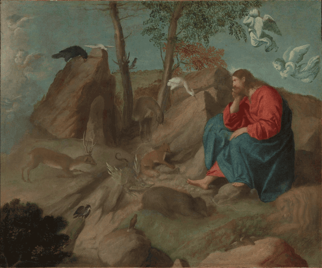
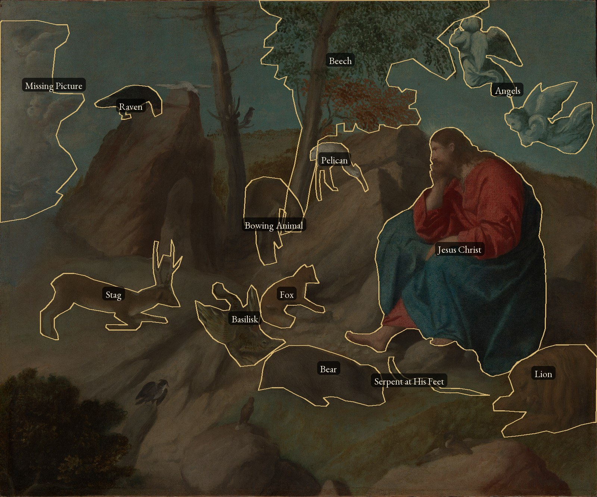
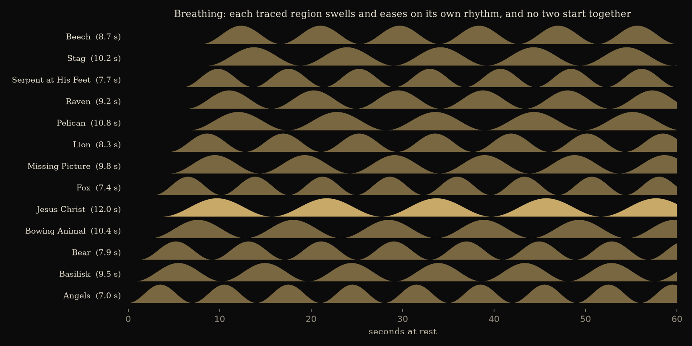
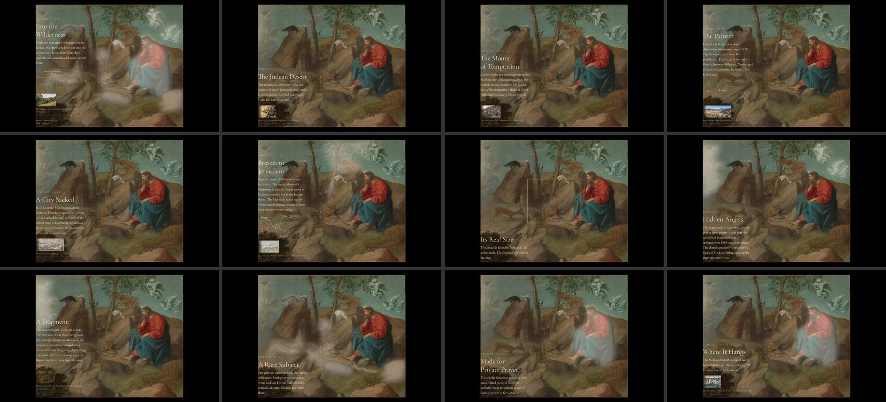
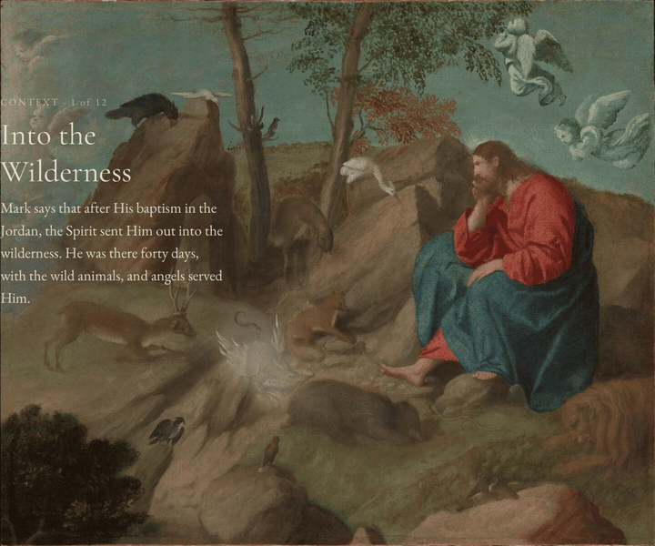
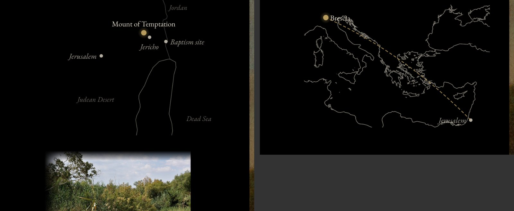
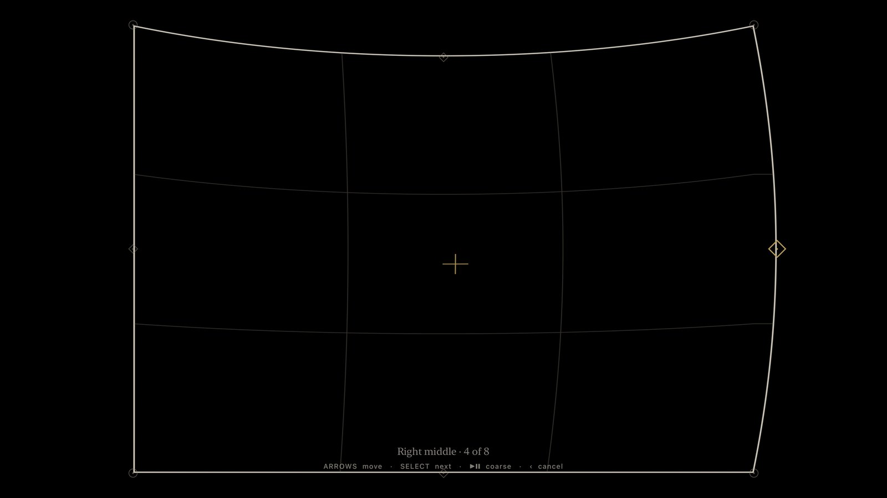
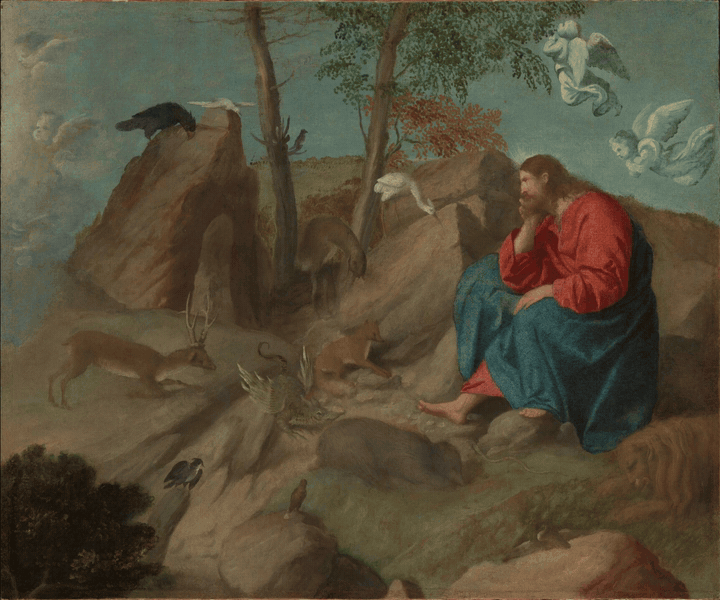
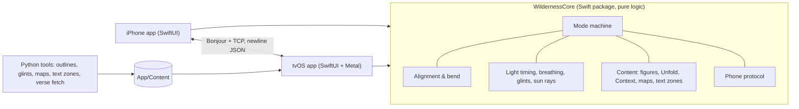

# The Wilderness

A projection-mapped tapestry of Moretto da Brescia's *Christ in the Wilderness* (about 1515–20,
The Metropolitan Museum of Art), made for a living room. An Apple TV drives a projector aimed
at a 60 × 50 inch tapestry print of the painting. Light finds each figure, the wall breathes at
rest, and short texts tell the story beside the figures they describe. An iPhone app guides it
from the sofa.

*The self-running demo in the tvOS simulator, with the painting shown under the light. On the
real wall the painting is the tapestry itself and the projector adds only light.*

---

## What it does

### Explore: light finds each figure

Thirteen figures in the painting are traced by hand. Press an arrow on the remote, or tap a
figure on the phone, and soft light gathers on that figure while the rest of the tapestry falls
back. A short line appears near it; press Select for the story and two verses, one from each
Testament.

Every claim on the wall is graded by its evidence. The Met names the basilisk and links it, the
lion and the serpent to Psalm 91:13, so those are marked documented. Nobody names the black bird
or the animal coming down the rocks, so the wall says so and reads them from what the painting
shows: a raven, perhaps, and an animal that bows its head toward Christ.

### Text that sits on the painting

The wall has no room beside the tapestry for text, so text sits on the painting itself. A
projector can only add light, which means ivory type reads well only over dark, calm passages.
`scripts/make_text_zones.py` scores every card-sized window of the painting for darkness and
calm, and keeps the best ones. The app then puts each figure's text in the nearest zone that
covers neither that figure nor Christ.

### The wall breathes

At rest, each traced region swells and eases on its own slow rhythm, between 7 and 11 seconds,
with Christ the slowest at 12. Start offsets are spread evenly across the regions so no two ever
pulse together; an early version hashed the names, and a test against the real outlines caught
two regions breathing in step.

Small glints drift and twinkle like shifting stars, landing on the painting's highlights and
favouring whichever region is breathing in. Every few minutes a few soft beams of sunlight slant
down from above, sweep across the canvas and fade.

### Unfold and Context

**Unfold** is an eight-part story told across the painting, from Eden to the wilderness, with the
light stepping through the figures as each beat names them. A content test fails if a beat ever
names a figure it does not light.

**Context** is twelve short pages about the painting and the place: the Judean desert, the Mount
of Temptation, Moretto's Brescia (sacked by the French in 1512, when he was about fourteen), the
1988 restoration that uncovered the hidden angels, and where the painting hangs now. Maps are
drawn from Natural Earth data as thin lines of light; photographs carry their licence credits.

### Eight-point alignment

A hanging tapestry is never quite flat. Four corners give a perspective mapping; four edge
midpoints let each edge bow to follow the cloth. The bend is a small Metal shader that runs after
the perspective step, so a calibration with straight edges renders exactly as before. Points can
be dragged on the phone, and the wall follows live.

| The alignment pattern, two edges bent | The painting through the same bend |
|---|---|
|  |  |

### The phone

The iPhone app finds the Apple TV on the home network (Bonjour), shows the painting with its
traced outlines, and mirrors whatever the wall is saying. From it you can jump to any figure,
page through Unfold and Context, tune the light, align the projection and start the demo.

### A demo for filming

Settings → Demo, or the phone, starts a three-minute loop that shows every feature once: the
boot-up outlines, the wall at rest with glints and a pass of sun rays, six figures, four beats of
Unfold, four Context pages. Any press ends it.

---

## How it is built

- **WildernessCore** holds everything that can be reasoned about without a screen: the mode
  machine, calibration and the bend, light timing, the content model and the phone protocol.
  Development was test-first; the package has 244 tests and the Python tools 158 more.
- **The tvOS app** draws in the artwork's own coordinates and warps the whole layer onto the
  tapestry with one homography, so every highlight and line of type is perspective-correct.
- **The iPhone app** talks to the wall over the local network only. No accounts, no cloud.
- **Content is data.** Figures, outlines, stories, Context pages, maps and text zones are JSON
  files, each validated on load and checked against the real files by tests.

Developer setup, signing and the tools are in [docs/DEVELOPING.md](docs/DEVELOPING.md).

## Scripture text

The app quotes the NIV on the wall through the API.Bible service, under its licence. That text is
fetched at build time into a git-ignored file and is **not in this repository**. The wording
committed here is the Berean Standard Bible and the Douay-Rheims, both public domain.

## Credits

- **Painting:** Moretto da Brescia, *Christ in the Wilderness*, ca. 1515–20. The Metropolitan
  Museum of Art, Rogers Fund, 1911 (11.53). Image public domain (Met Open Access).
- **Maps:** Natural Earth (public domain). Place coordinates from Wikipedia.
- **Photographs** (Context pages):
  - Bahnfrend, CC BY-SA 4.0, via Wikimedia Commons (the Jordan at Qasr al-Yahud)
  - Britchi Mirela, CC BY-SA 4.0, via Wikimedia Commons (Wadi Qelt)
  - Dmitrij Rodionov, CC BY-SA 3.0, via Wikimedia Commons (Monastery of the Temptation)
  - Wolfgang Moroder, CC BY-SA 3.0, via Wikimedia Commons (Brescia)
  - Margaret L. Huggins, *Gio. Paolo Maggini: His Life and Works* (1894), public domain (old view of Brescia)
  - Edward Lear, *Lago d'Iseo*, 1867, Yale Center for British Art, CC0
  - Moretto da Brescia, *Christ Blessing Saint John the Baptist*, National Gallery, London (NG3096), public domain
  - Yair Haklai, CC BY-SA 4.0, via Wikimedia Commons (The Met, Fifth Avenue)
- **Fonts:** Cormorant Garamond and EB Garamond, SIL Open Font License.
- **Research sources** for every Context page and figure are listed beside the text in
  `App/Content/context.json` and `App/Content/annotations.json`.

## License

The code is under the [MIT License](LICENSE). The painting, photographs, maps and fonts keep
the licences listed under Credits; scripture text is not part of this repository.

Made by Matt McCoy, 2026.
