

  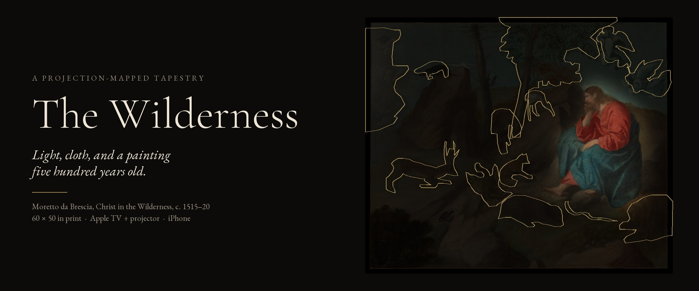

# The Wilderness

Moretto da Brescia painted *Christ in the Wilderness* around 1515. It hangs in the Metropolitan
Museum of Art. A 60 × 50 inch print of it hangs in my living room, and an Apple TV and a projector
light it from across the room. Light finds each figure, the wall breathes when no one is touching
it, and short texts tell the story on the cloth beside the figures they describe. An iPhone app
guides it from the sofa.

I designed it the way I would design a product: a fixed object, a room, a set of constraints the
physics won't negotiate, and a person on a sofa who should never have to think about any of it.

*The self-running demo in the tvOS simulator, with the painting drawn under the light. On the real
wall the painting is the cloth itself and the projector adds only light.*

---

## The brief

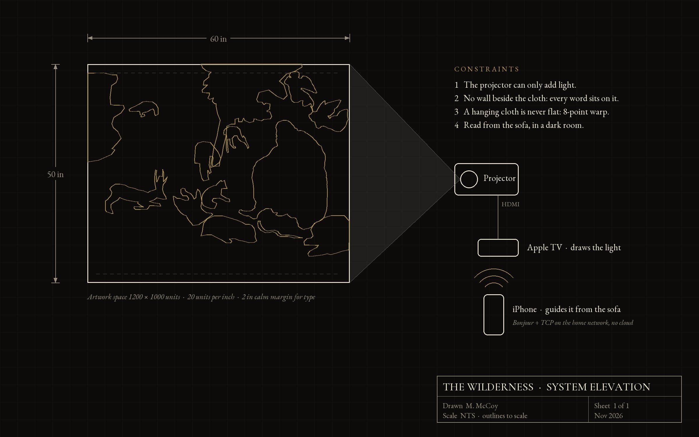

Four constraints shaped every decision.

1. **A projector can only add light.** There is no black paint and no shadow to draw. Everything
   on the wall is light added to a printed cloth, so dark is simply the absence of light, and
   ivory type only reads over the painting's dark, quiet passages.
2. **There is no wall beside the tapestry.** The print fills the projector's frame. Every word the
   wall says, from a figure's story to the alignment instructions, has to sit on the painting.
3. **A hanging cloth is never flat.** It bows, it sags at the corners, and the printer trimmed a
   sliver off the top. The light has to land on the cloth, not where the cloth should be.
4. **It lives in a living room.** It is read from the sofa, in the dark, by people who did not come
   to operate software. It should be calm by default and rewarding when you lean in.

## Design language

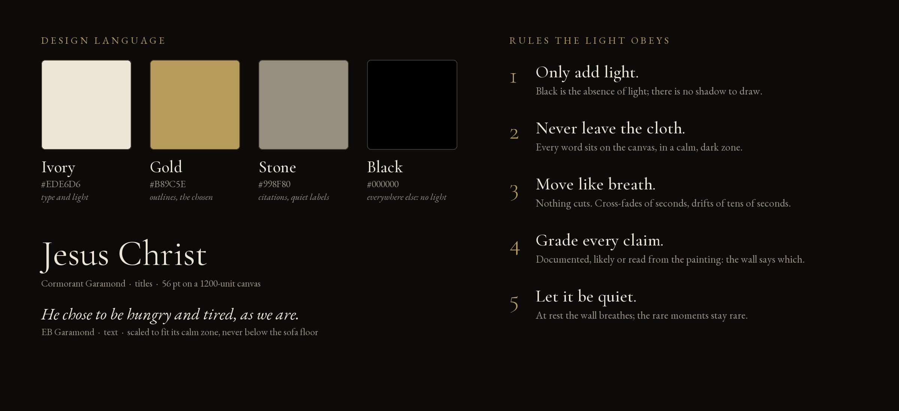

The palette is four values: ivory for type and light, gold for outlines and the chosen figure,
stone for quiet labels, and black, which on a projector means *no light at all*. The type is
Cormorant Garamond for titles and EB Garamond for text, set to fit its calm zone and never below a
size readable from the sofa. The phone uses the same black, Garamond and gold, so the two feel
like one object.

---

## On the wall

### Light finds each figure

Thirteen figures are traced by hand. Press an arrow on the remote, or tap a figure on the phone,
and soft, heavily feathered light gathers on that figure while the rest of the tapestry falls
back. A short line appears near it; press Select for the story and a verse from each Testament.

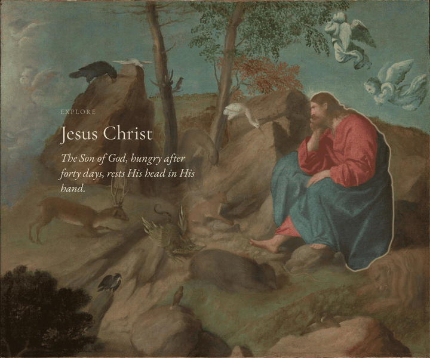

Every claim on the wall is graded by its evidence. The Met names the basilisk and links it, the
lion and the serpent to Psalm 91:13, so those are marked documented. Nobody names the black bird
or the animal coming down the rocks, so the wall says so and reads them from what the painting
shows: a raven, perhaps, and an animal that bows its head toward Christ.

### Type that sits on the painting

Because the light can only add, type has to find the painting's dark, calm passages.
`scripts/make_text_zones.py` scores every card-sized window of the painting for darkness and calm
and keeps the best ones. Each figure's text goes in the nearest zone that covers neither that
figure nor Christ, with a two-inch margin from the edge of the cloth and type scaled to fit.

| Calm zones scored on the painting | The raven's text on the shadowed rock |
|---|---|
| 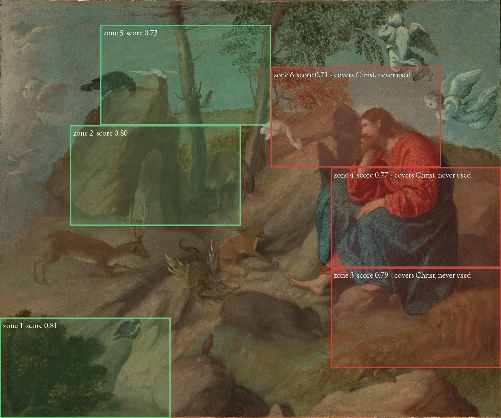 | 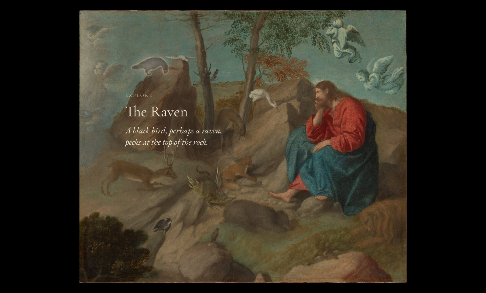 |

### The wall breathes, and the light drifts

At rest, each traced region swells and eases on its own slow rhythm, between 7 and 11 seconds,
with Christ the slowest at 12. Start offsets are spread so no two regions ever pulse together; an
early version hashed the names, and a test against the real outlines caught two breathing in step.

Over the breathing, a soft light drifts from figure to figure, forty seconds on each and fifteen
to ease into the next. It always moves to the nearest figure it hasn't visited, so it travels
across the painting instead of jumping about. Small glints land on the painting's highlights, and
every few minutes a few soft beams of sunlight slant down from above and fade.

**Be still** leaves Christ alone in the light and lets his own words come and go on the canvas, one
every half minute: the sayings of Jesus, with the Old Testament verses that point to him set in gold
between them. It runs until any button.

### Into the quiet

A way into contemplative prayer, morning or night, started from the phone. It follows the old
shape of *lectio divina*: **Read** one short line of scripture, set large on the canvas, then
**Reflect**, **Respond** and **Rest** in silence while only Christ's light remains, breathing once
every fourteen seconds. The rest of the wall goes still: no glints, no drifting light, no seasons.
A soft bowl breath marks each movement. The line changes each day, from a morning set and an
evening set. After a late session the light fades out and the Apple TV is left to sleep.

### Unfold and Context

**Unfold** is an eight-part story told across the painting, from Eden to the wilderness, the light
stepping through the figures as each beat names them. A content test fails if a beat ever names a
figure it does not light.

**Context** is twelve short pages about the painting and the place: the Judean desert, the Mount of
Temptation, Moretto's Brescia (sacked by the French in 1512, when he was about fourteen), the 1988
restoration that uncovered the hidden angels, and where the painting hangs now. Maps are drawn
from Natural Earth data as thin lines of light. On the restoration page, the angels' outlines draw
themselves in and then glow.

| The restoration page | Real maps drawn as light |
|---|---|
| 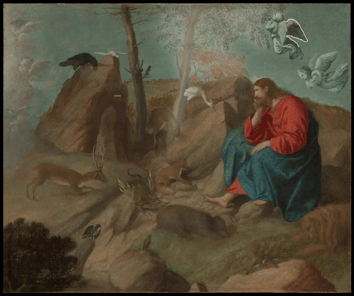 |  |

---

## Through the year

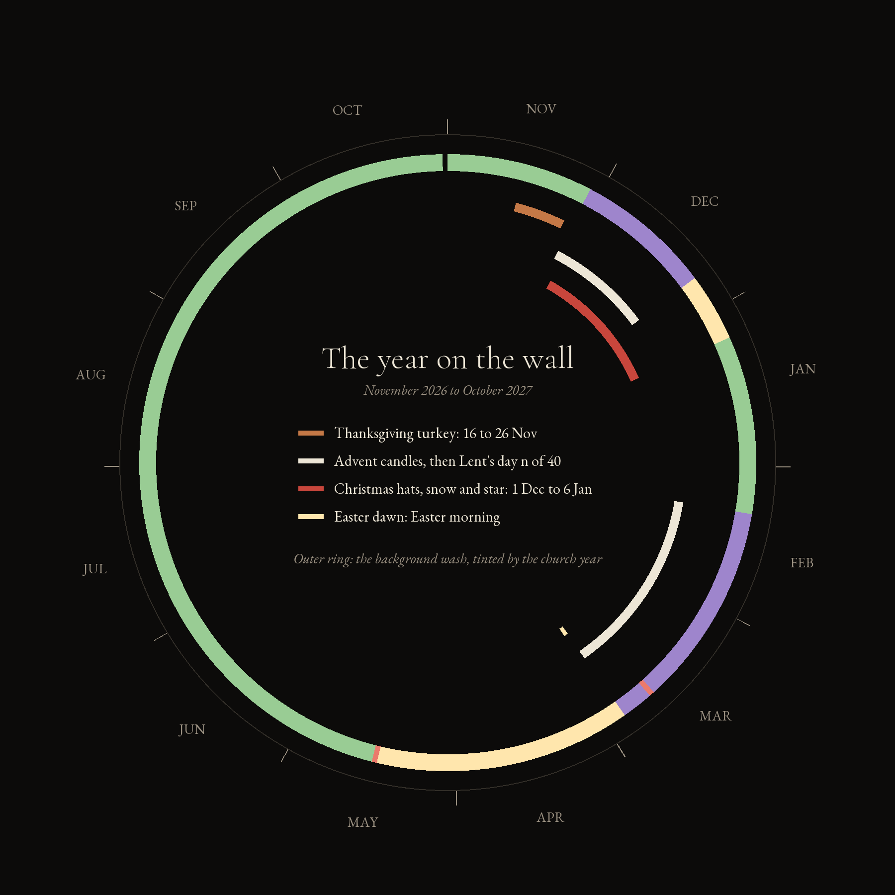

The wall keeps the church calendar: Easter by the Gregorian computus, everything else hung from it.
The background wash takes the season's colour, and all the light warms and dims with the day, from
sunrise and sunset at home.

| Christmas | Thanksgiving | Easter morning |
|---|---|---|
| 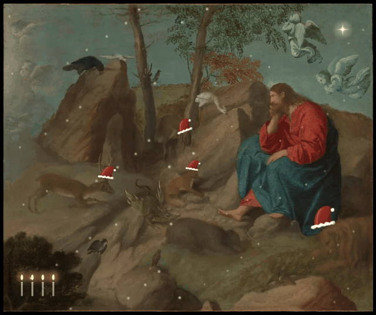 | 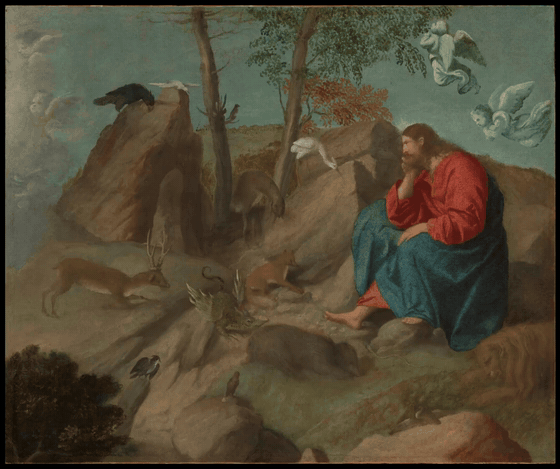 | 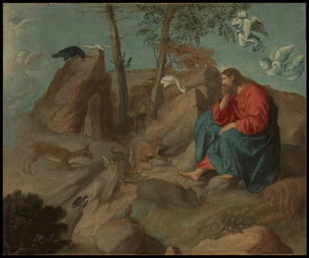 |
| Hats of soft red light on the lion, the stag, the bowing animal and the fox; snow; a star over the angels on Christmas Eve and at Epiphany. Advent candles count the Sundays. | From the Monday of the week before Thanksgiving through the day, a turkey trots along the far hill and, a little later, bolts through the foreground. | A gold dawn sweeps across the painting on Easter Sunday morning. In Lent the wall counts the forty days. |

The hats and the star were placed by hand with a small drag-and-drop page that draws them exactly
as the wall does. They are shaded in the painting's own vermilion and lit from the upper left,
like the figures, so they look like they belong in it. Each season can be set to Auto, On or Off,
from the wall's Tune screen or the phone.

A few times an evening, at times that change every day, something small happens at rest: the stag
leaps, the raven's eye catches the light, the angels brighten together. Late in the evening the
wall settles to breathing only and lets the Apple TV sleep. And there is a code.

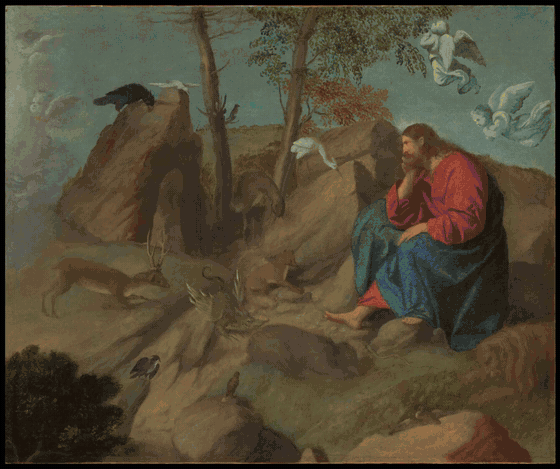

---

## The phone

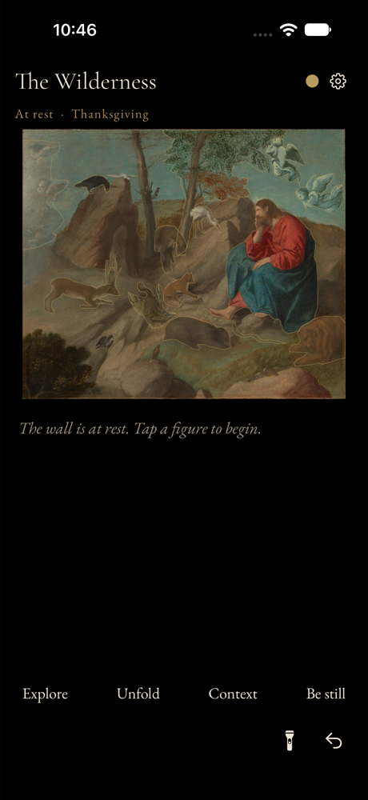

The iPhone app finds the Apple TV on the home network, shows the painting with its traced
outlines, and mirrors the wall: the line under the title always says what the wall is doing, and
the mode that is running is lit gold.

Everything the remote can do, the phone can do: explore any figure, Unfold, Context, Be still,
hide the text, tune every light value and season, align the projection, show the alignment
pattern, start the demo. It can also be a flashlight: drag a finger across the painting and a pool
of light follows on the wall. Siri can start the demo, hide the text or turn on the flashlight.

Every press is felt and seen. A press that cannot reach the wall says so, and the connection dot
pulses whenever the wall answers.

 

---

## Details that took the longest

**Eight-point alignment.** Four corners give a perspective mapping; four edge midpoints let each edge
bow to follow the cloth. The bend is a small Metal shader that runs after the perspective step, so
a calibration with straight edges renders exactly as before. Handles can be dragged on the phone
and the wall follows live.

| The alignment pattern, two edges bent | The painting through the same bend |
|---|---|
|  | 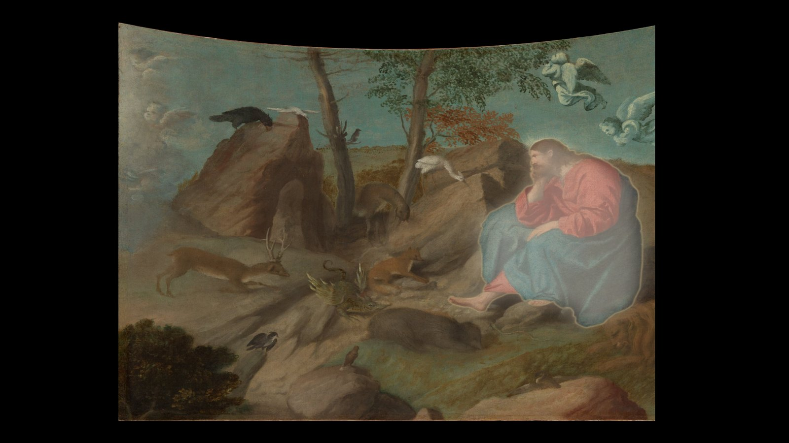 |

**Painting trim.** The printer cut a sliver off the top of the painting, so the handles sat on the
cloth's edge while the figures sat low. A per-edge trim, in sixteenths of an inch and set from the
phone while the figures' outlines are drawn on the wall, fits the painting inside the cloth. Anything
that would fall past the cloth is masked, so no light reaches the wall around it.

**Light that adds.** Where two shapes overlap, a projector adds their light, so a turkey's tail
feathers or a hat's fur would bloom into a bright smear. Each is drawn as one picture first and then
added as light. Snow fell in faint diagonal rows until its scatter was replaced with a proper hash.

**Sound that answers the wall.** The optional sound is made from real recordings, not synthesis: a
meditation choir and a soft pad in D, looped at different lengths so they never line up the same
way twice. The bed brightens and swells a little with Christ's twelve-second breath. Moving to a
figure breathes the hum of a Tibetan singing bowl with its strike cut away, tuned so each figure
has its own note of D major pentatonic: Christ is home, and the others rise from left to right
across the painting.

**A demo for filming.** Settings → Demo starts a loop of about a minute and a half that shows each part once.
Any press ends it.

---

## How it is built

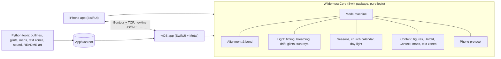

- **WildernessCore** holds everything that can be reasoned about without a screen: the mode
  machine, calibration and the bend, the light's timing and drift, the church calendar, the content
  model and the phone protocol. It was built test-first: 321 tests, and 165 more for the Python tools.
- **The tvOS app** draws in the artwork's own coordinates (1200 × 1000 units, twenty to the inch)
  and warps the whole layer onto the tapestry, so every highlight and line of type lands
  perspective-correct on the cloth.
- **The iPhone app** talks to the wall over the local network only. No accounts, no cloud.
- **Content is data.** Figures, outlines, stories, Context pages, maps, text zones, hats and the
  turkey's path are JSON files, each validated on load and checked against the real files by tests.
- **The README's graphics** are drawn by `scripts/make_readme_art.py` from the same outlines,
  palette, fonts and calendar rules the app uses.

Developer setup, signing and the tools are in [docs/DEVELOPING.md](docs/DEVELOPING.md).

## Scripture text

The app quotes the NIV on the wall through the API.Bible service, under its licence. That text is
fetched at build time into a git-ignored file and is **not in this repository**. The wording
committed here is the Berean Standard Bible and the Douay-Rheims, both public domain.

## Credits

- **Painting:** Moretto da Brescia, *Christ in the Wilderness*, ca. 1515–20. The Metropolitan
  Museum of Art, Rogers Fund, 1911 (11.53). Image public domain (Met Open Access).
- **Maps:** Natural Earth (public domain). Place coordinates from Wikipedia.
- **Photographs** (Context pages):
  - Bahnfrend, CC BY-SA 4.0, via Wikimedia Commons (the Jordan at Qasr al-Yahud)
  - Britchi Mirela, CC BY-SA 4.0, via Wikimedia Commons (Wadi Qelt)
  - Dmitrij Rodionov, CC BY-SA 3.0, via Wikimedia Commons (Monastery of the Temptation)
  - Wolfgang Moroder, CC BY-SA 3.0, via Wikimedia Commons (Brescia)
  - Margaret L. Huggins, *Gio. Paolo Maggini: His Life and Works* (1894), public domain (old view of Brescia)
  - Edward Lear, *Lago d'Iseo*, 1867, Yale Center for British Art, CC0
  - Moretto da Brescia, *Christ Blessing Saint John the Baptist*, National Gallery, London (NG3096), public domain
  - Yair Haklai, CC BY-SA 4.0, via Wikimedia Commons (The Met, Fifth Avenue)
- **Sound:** CC0 recordings from Freesound: a meditation choir (zazz.sound.design), a pad
  (PhonZz) and a Tibetan singing bowl (dersinnsspace). Details in `App/Sound/CREDITS.md`.
- **Fonts:** Cormorant Garamond and EB Garamond, SIL Open Font License.
- **Research sources** for every Context page and figure are listed beside the text in
  `App/Content/context.json` and `App/Content/annotations.json`.

## License

The code is under the [MIT License](LICENSE). The painting, photographs, maps and fonts keep the
licences listed under Credits; scripture text is not part of this repository.

Designed and built by Matt McCoy, 2026.
